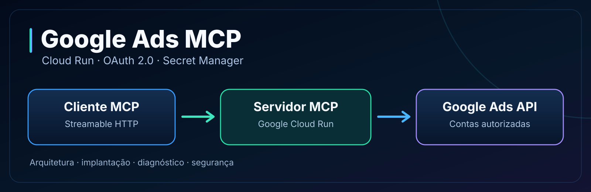

# Google Ads MCP on Google Cloud Run

  

You want to answer, “Which campaigns spent the most in the last 30 days, and how can I check the figures?” This tutorial shows how to host the official [Google Ads MCP](https://github.com/googleads/google-ads-mcp) server on Google Cloud Run. The AI client sends requests over HTTPS; Cloud Run hosts the MCP server, which queries the Google Ads API with the access you authorize. Each step has a checkpoint so you can tell what is working.

The server code belongs to Google's official project. This repository explains one deployment; it is not an official Google product or a promise that every account will be production-ready. Configuration names and requirements can change between versions.

For this revision, the walkthrough uses upstream commit `44ca7770519362c8f334875477e1ceb499f8d2dd` (package version 0.0.6). This is a commit reviewed for this guide, not a claim that it is a stable release. The deployment guide records what changes in image preparation.

## What you will have when you finish

You will be able to get the service's HTTPS URL and connect an MCP-compatible client to the `/mcp` path. The checkpoints help confirm, in order, that Cloud Run published the service, that anonymous access is rejected when OAuth is enabled, that the client completed sign-in and discovered the tools, and that an authorized query to the Google Ads API returned the expected data.

A `401` in the no-login test can be normal, but by itself it does not prove that OAuth or an ads query works. Full validation requires an MCP client, a Google identity with access to the account, and an authorized query. This tutorial does not claim that a new deployment has been run or tested in the cloud.

## Four checks before you start

Clear these four prerequisites before creating resources. If one depends on your company's Cloud or Google Ads team, share the relevant link and request the access you need.

1. **Google Cloud project and billing.** You need a project with billing enabled and permission to enable APIs, create resources and identities, grant access to secrets, and publish services. Your organization may require someone with specific permissions to run some commands. Builds, storage, logs, traffic, and execution can incur charges. Budget alerts help you track spending, but they are not an automatic spending cap.
2. **Google Ads API access.** The API must be enabled in the project, and that project needs an access level suitable for the environment: test or production accounts. Google updated the access process in 2026; for new access, see the Google Ads API overview page in the Google Cloud Console. Projects or server versions that already use older credentials may have additional requirements: follow the official documentation for the commit you pinned.
3. **OAuth and account access.** You need to configure an OAuth client and register the exact server redirect URL required by the pinned commit. The MCP client starts another step in the flow; do not register its URL as the server callback. The person who completes sign-in also needs access to the desired ads account. Access through a manager account (MCC) is needed only when your account setup depends on it.
4. **MCP client and usage mode.** Choose a client that supports Streamable HTTP and can complete the OAuth flow described by the server version. Before authorizing a real account, check which tools that version exposes: the server may create assets or change labels in Google Ads. OAuth does not make the tools read-only.

## Guided path

Follow the steps in order. The first guide explains each setup command and shows a checkpoint before you move on.

| Step | What happens | Guide |
| --- | --- | --- |
| 1. Prepare | Check access, tools, and project; enable the required services | [Prerequisites](docs/en/getting-started/PREREQUISITES.md) |
| 2. Prepare the version | Check the reference commit and configured tool list | [Deployment](docs/en/getting-started/DEPLOY.md) |
| 3. Set up OAuth | Configure sign-in and keep secrets out of source code | [OAuth and Secret Manager](docs/en/guides/OAUTH-AND-SECRETS.md) |
| 4. Build and publish | Return to the deployment guide to build the image and publish the service | [Deployment](docs/en/getting-started/DEPLOY.md) |
| 5. Validate | Check the URL, sign-in, visible tools, and a test query | [Validation](docs/en/guides/VALIDATION.md) |
| 6. Diagnose and maintain | Investigate errors, costs, revisions, and maintenance | [Troubleshooting](docs/en/guides/TROUBLESHOOTING.md) · [Costs](docs/en/guides/COSTS.md) · [Operations](docs/en/guides/OPERATIONS.md) |

If you are still evaluating the idea, start with [Architecture](docs/en/ARCHITECTURE.md), [Costs](docs/en/guides/COSTS.md), the [Glossary](docs/en/GLOSSARY.md), and [supplementary videos in Portuguese](docs/en/guides/VIDEOS-PT-BR.md). The videos explain concepts and navigation; they do not replace current operational steps. The complete list is in the [documentation index](docs/en/README.md).

## Reproduction and acceptance testing

Reproducing this guide confirms only the checkpoints you ran, with the project, region, server version, and client you chose. It does not establish security, cost, or availability for every account, and it does not make the deployment production-ready.

To accept the setup for use in your organization, validate it with a test or authorized account, confirm the tool list, and restrict exposed actions to fit your internal process. Have the responsible teams review OAuth, persistence, permissions, logs, costs, quotas, and failure recovery before connecting production accounts. The test list describes the evidence to look for; it is not a certificate issued by this repository.

## Ask an AI tutor for help

You can copy the [prompt for ChatGPT or Codex](docs/en/guides/AI-TUTOR.md) along with the documentation excerpts you are following. It guides the tutor to explain commands, pause at checkpoints, and ask before actions that change resources or could incur charges. **Do not paste passwords, keys, tokens, secret values, cookies, or credential files**; replace confidential values with `[CONFIDENTIAL DATA HIDDEN]`.

## Documentation in Portuguese and English

- Portuguese: [index](docs/README.md) · [glossary](docs/GLOSSARY.md) · [AI tutor](docs/guides/AI-TUTOR.md) · [supplementary videos](docs/guides/VIDEOS-PT-BR.md)
- English: [README](README.en.md) · [documentation index](docs/en/README.md) · [glossary](docs/en/GLOSSARY.md) · [AI tutor](docs/en/guides/AI-TUTOR.md)

## Main references

- [Official Google Ads MCP server](https://github.com/googleads/google-ads-mcp)
- [Get started with the Google Ads API](https://developers.google.com/google-ads/api/docs/get-started/introduction)
- [Google Ads API access levels](https://developers.google.com/google-ads/api/docs/api-policy/developer-token?hl=en)
- [Cloud Run documentation](https://cloud.google.com/run/docs)
- [Reference index for this guide](docs/en/REFERENCES.md)
- [Guide license](LICENSE) · [Third-party notices](THIRD_PARTY_NOTICES.md)
