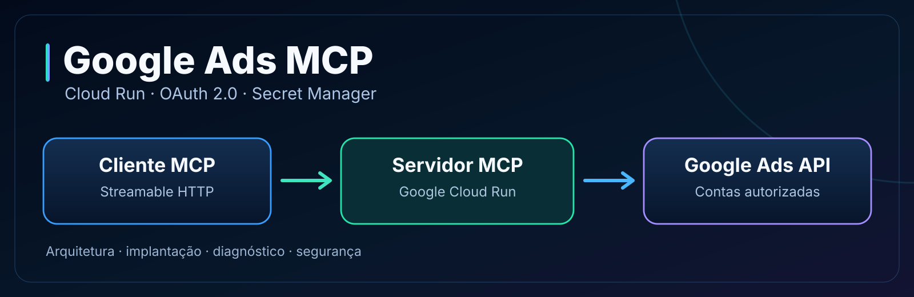
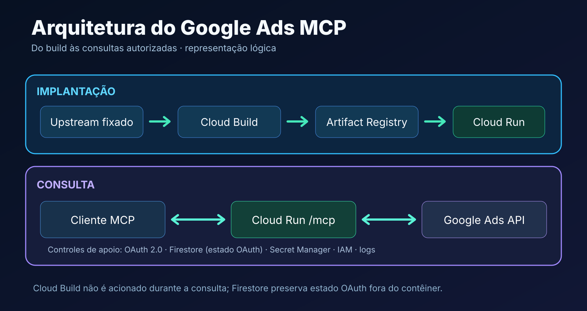

# Google Ads MCP · Guia de Implantação no Cloud Run

<p align="center">
  
</p>

**Implante o servidor oficial [Google Ads MCP](https://github.com/googleads/google-ads-mcp) no Google Cloud Run**, com Streamable HTTP, OAuth 2.0, Secret Manager e integração à Google Ads API.

## 🧭 Documentação

| O que você precisa? | Acesse |
| --- | --- |
| Preparar o Google Cloud e o Google Ads | [Pré-requisitos](docs/getting-started/PREREQUISITES.md) |
| Construir a imagem e publicar no Cloud Run | [Implantação passo a passo](docs/getting-started/DEPLOY.md) |
| Configurar OAuth e credenciais | [Autenticação e segredos](docs/guides/OAUTH-AND-SECRETS.md) |
| Conectar um cliente e testar | [Validação](docs/guides/VALIDATION.md) |
| Resolver erros de OAuth e HTTP | [Troubleshooting](docs/guides/TROUBLESHOOTING.md) |
| Entender o desenho técnico | [Arquitetura](docs/ARCHITECTURE.md) |
| Acompanhar custos e manutenção | [Custos](docs/guides/COSTS.md) · [Operação](docs/guides/OPERATIONS.md) |
| Navegar por todos os documentos | [Índice completo](docs/README.md) |

## 🚀 Roteiro rápido

**1. Obtenha o servidor oficial e escolha uma versão.**

```bash
# Baixa o código-fonte do servidor oficial.
git clone https://github.com/googleads/google-ads-mcp.git

# Entra na pasta clonada.
cd google-ads-mcp

# Lista as versões marcadas pelo projeto.
git tag --list

# Após revisar a versão desejada, substitua VERSAO_ESCOLHIDA pelo nome real:
# git checkout VERSAO_ESCOLHIDA
```

**2. Configure o projeto e prepare os serviços.**

```bash
# Informe o identificador do SEU projeto no Google Cloud.
export PROJECT_ID="SEU_PROJECT_ID"

# Define a região e o nome do serviço que será criado.
export REGION="us-central1"
export SERVICE="google-ads-mcp"

# Seleciona o projeto para os próximos comandos gcloud.
gcloud config set project "$PROJECT_ID"

# Habilita as APIs necessárias para construir e executar o servidor.
gcloud services enable \
  googleads.googleapis.com \
  run.googleapis.com \
  cloudbuild.googleapis.com \
  artifactregistry.googleapis.com \
  secretmanager.googleapis.com
```

**3. Siga a implantação.** O guia separa build, Cloud Run, OAuth, armazenamento de segredos e testes, com comandos parametrizados.

[**Ver o passo a passo da implantação →**](docs/getting-started/DEPLOY.md)

## 🏗️ Arquitetura



```text
IMPLANTAÇÃO
Código oficial do Google Ads MCP
    → Cloud Build
    → Artifact Registry
    → Cloud Run

CONSULTA
Cliente MCP
    ↔ HTTP com transmissão contínua (Streamable HTTP) + OAuth
    ↔ Google Ads MCP / Cloud Run
    ↔ Google Ads API
```

## 🧪 Verificação

O roteiro de validação cobre:

- Estado do serviço e resposta HTTP;
- Autenticação OAuth;
- Descoberta de ferramentas MCP;
- Listagem de contas autorizadas;
- Consulta GAQL;
- Teste negativo sem autenticação.

[**Abrir matriz de testes →**](docs/guides/VALIDATION.md)

## 🛠️ Solução de problemas

| Erro | Onde investigar |
| --- | --- |
| `redirect_uri_mismatch` | URLs autorizadas e callback OAuth |
| `invalid_client` | Identificador do cliente OAuth, versão do segredo e configuração do serviço |
| HTTP `401` | Solicitação não autenticada — pode ser o comportamento esperado |
| Ferramentas não aparecem | Endereço do servidor, versão MCP, OAuth e configuração do cliente |
| Contas não aparecem | Identidade Google e permissões Google Ads |

[**Abrir solução de problemas →**](docs/guides/TROUBLESHOOTING.md)

## 📚 Referências

- [Código oficial — googleads/google-ads-mcp](https://github.com/googleads/google-ads-mcp)
- [Documentação Google Ads API](https://developers.google.com/google-ads/api)
- [Documentação Google Cloud Run](https://cloud.google.com/run/docs)
- [Índice da documentação deste guia](docs/README.md)
