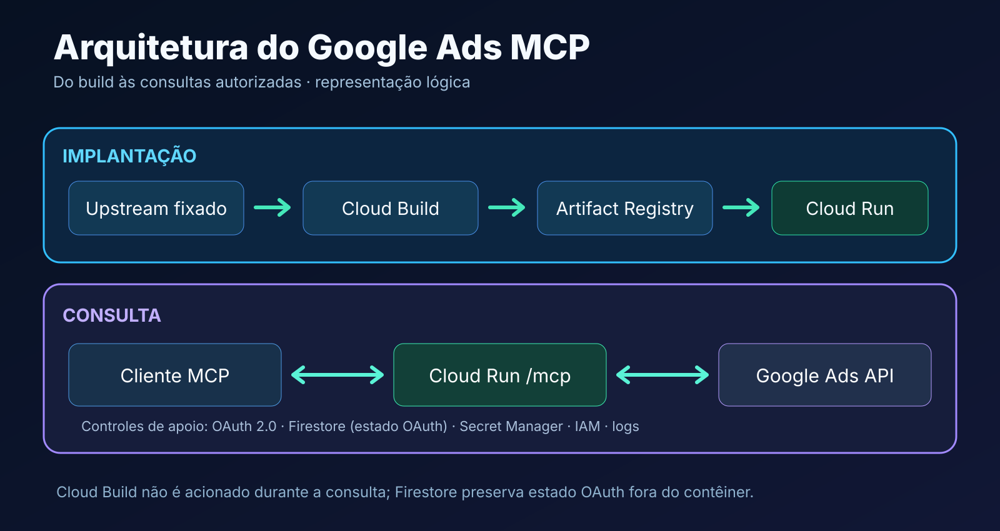

# Arquitetura



## Componentes

| Serviço | Função |
| --- | --- |
| Google Ads MCP | Disponibiliza ferramentas MCP conectadas à Google Ads API |
| Cloud Run | Executa o servidor HTTP |
| Cloud Build | Constrói a imagem do contêiner |
| Artifact Registry | Armazena a imagem publicada |
| OAuth 2.0 | Autoriza o cliente e o acesso à API |
| Secret Manager | Armazena o segredo OAuth e a chave de assinatura |
| Google Ads API | Fornece os dados das contas autorizadas |

## Fluxo de implantação

```text
Código oficial → Cloud Build → Artifact Registry → Cloud Run
```

## Fluxo de consulta

```text
Cliente MCP → HTTPS /mcp → Servidor Google Ads MCP → Google Ads API
          ←                 ←                        ←
```

OAuth, IAM e Secret Manager sustentam autenticação e gestão de credenciais. Cloud Build e Artifact Registry **não são acionados em cada consulta**.

## Configuração

- **Transporte:** Streamable HTTP.
- **Endpoint:** `https://SEU-SERVICO.../mcp`.
- **Identidade:** OAuth e permissões Google Ads.
- **Logs:** Cloud Run / Cloud Logging.
- **Estado OAuth:** planejar persistência compatível com o número de instâncias e reinicializações.

Próximo: [Implantação](getting-started/DEPLOY.md).
