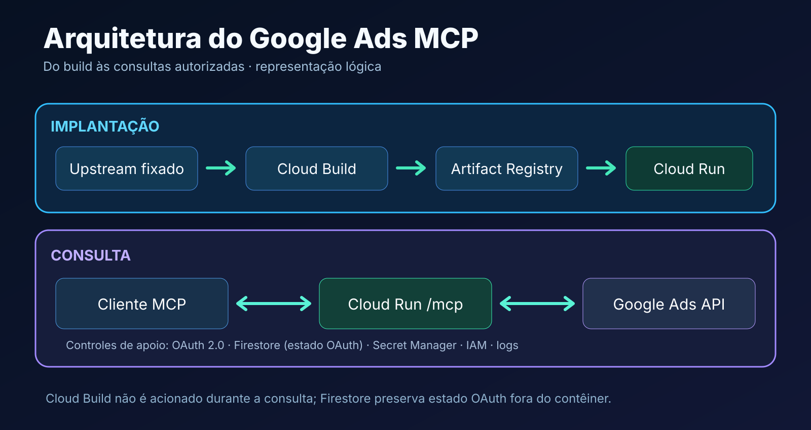

# Visão geral

**Problema:** compreender como disponibilizar ferramentas do Google Ads a aplicações de IA em uma arquitetura remota, reutilizável e orientada por segurança.

**Solução estudada:** execução do **servidor oficial Google Ads MCP** em Cloud Run com Streamable HTTP e OAuth 2.0.

**Contexto:** modernização de fluxos de análise de marketing que combinam sistemas institucionais, CRM/relacionamento e plataformas de publicidade. O MCP é a interface entre cliente e ferramentas; **não substitui** banco de dados, conciliação, ETL ou métricas determinísticas.

## Duas camadas de leitura

**Capô fechado:** [Arquitetura](ARCHITECTURE.md) explica objetivos, resultados, limites e decisões.

**Capô aberto:** siga [pré-requisitos](getting-started/PREREQUISITES.md), [deploy](getting-started/DEPLOY.md), [OAuth](guides/OAUTH-AND-SECRETS.md) e [validação](guides/VALIDATION.md).

Este guia não é a fonte normativa do software: consulte o [servidor oficial](https://github.com/googleads/google-ads-mcp).
