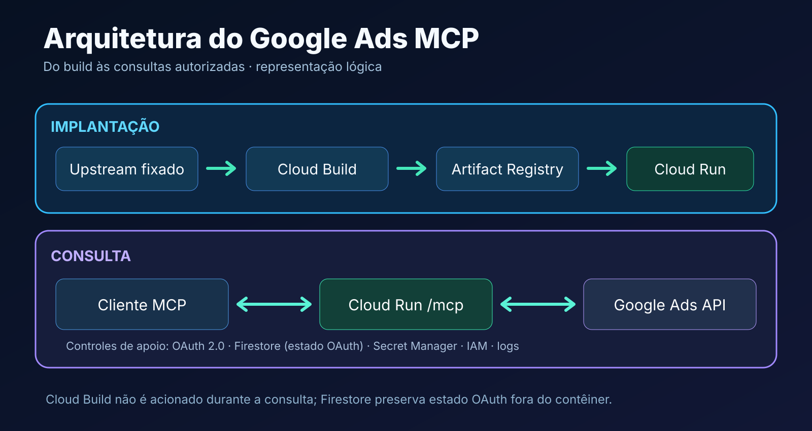

# Architecture

The article *Construir ou integrar?* describes two complementary layers: code and SQL for reproducible calculations and business rules, and language models for interpreting validated results. This guide focuses on access to one data source: the Google Ads API, through the official MCP server hosted on Cloud Run.

Use the component map below to understand what each service does. Then follow the [deployment guide](getting-started/DEPLOY.md), which pins the upstream version and provides commands and checkpoints.

## Components

| Component | Role and boundary |
| --- | --- |
| Google Ads MCP | Official server. With a Client ID and Client Secret configured, it starts Streamable HTTP and authenticates users through Google OAuth. |
| Cloud Run | Keeps the HTTP service accessible to the MCP client. Cloud Run IAM controls who may invoke the service; it does not grant access to Google Ads accounts. |
| Google OAuth | Signs in the user and authorizes the `https://www.googleapis.com/auth/adwords` scope. The FastMCP proxy uses a fixed Web credential for the application and forwards the callback to the MCP client. |
| Google Ads API | Access depends on the Cloud project that owns the OAuth credentials, the access level approved for that project, and the Google Ads account permissions of the user. |
| Firestore | Persists OAuth state across instances and restarts. The image must be built with the `firestore` extra, and the Cloud Run service account must have database access. |
| Secret Manager | Supplies three secrets to the Cloud Run revision: the OAuth Client Secret, JWT signing key, and OAuth storage key. This guide uses a storage key independent of the JWT key. |
| Cloud Build and Artifact Registry | Build and store the image. They do not participate in each query. |
| Cloud Logging | Receives operational logs and structured audit events from the server. Even so, limit who can read the logs. |

## Deployment flow

Deployment starts from the pinned upstream commit, passes through Cloud Build and Artifact Registry, and ends in a Cloud Run revision.

Record the source commit and the digest of the deployed image. A container tag alone does not immutably identify the code being run.

## Authentication and query flow

1. The MCP client accesses `https://YOUR-SERVICE.run.app/mcp` and discovers that the resource requires OAuth.
2. The client completes OAuth with the FastMCP server. The proxy dynamically registers the MCP client and forwards the user to Google; you do not register each local client's callback in the Google Console.
3. The server's Web OAuth credential returns to `https://YOUR-SERVICE.run.app/auth/callback`. This is the Google callback for the FastMCP proxy; `/mcp` is the MCP endpoint and is not part of the callback.
4. After authorization, the client sends `tools/list` and `tools/call` over Streamable HTTP at `/mcp`.
5. The `search_search` tool queries authorized data using GAQL; `customers_list_accessible_customers` and `metadata_get_resource_metadata` help discover accounts and fields.

`GOOGLE_ADS_MCP_BASE_URL` must be the public HTTPS origin of the service, without the `/mcp` suffix. With the `GoogleProvider` in this commit, the default callback path is `/auth/callback`.

## Access boundaries

- **Cloud Run ingress:** `--allow-unauthenticated` makes the service reachable from the internet so OAuth and MCP clients can start a connection. It does not authenticate the user or grant Google Ads access. The public endpoint can still receive anonymous traffic and incur charges.
- **Application sign-in:** the user must complete OAuth and approve the scopes shown by Google. Do not put the server's Client Secret in the MCP client configuration.
- **Google Ads access:** the OAuth user needs access to the account. The Google Ads user role controls the effective level; the API has no separate OAuth scope for read-only access. The project that owns the Client ID must have the Google Ads API enabled and the appropriate access level for the intended data. Deploying to Cloud Run does not approve that access.
- **Read tools:** this deployment's `tools_config.yaml` should enable only `customers`, `search`, and `metadata`, and disable `labels` and `assets`. Tool configuration does not change the OAuth scope or replace account permissions.
- **Storage:** Firestore persists OAuth state, not in-memory HTTP session state, open SSE streams, or MCP subscriptions. After a restart, the client may need to reconnect and initialize a new session.

Google ended developer tokens on September 9, 2026. For new projects, Google Ads API access is granted to the Cloud project associated with the OAuth credentials; no developer token setup is needed. Check the current access level in the Console before querying production accounts: [official developer-token policy](https://developers.google.com/google-ads/api/docs/api-policy/developer-token) and [Google Ads access model](https://developers.google.com/google-ads/api/docs/oauth/access-model).

## State and scale on Cloud Run

The server uses stateful Streamable HTTP by default. Do not configure `stateless_http`: the upstream documents interoperability with both clients that use `Mcp-Session-Id` and GET/SSE and clients that use POST without a session and `subscriptions/listen`. Firestore stores OAuth state; it does not make MCP sessions or streaming connections durable.

With `min-instances=0`, Cloud Run may stop idle instances. This saves the cost of warm instances, but increases startup latency and interrupts in-memory session state when an instance stops. `min-instances=1` may reduce cold starts, but costs more and still does not prevent restarts. Cloud Run session affinity is best effort, not a guarantee that every request reaches the same instance. For this evaluation deployment, limit the service to one instance and reconnect the client after restarts; do not treat this setup as high availability.

## Primary sources

- [Google Ads MCP — reviewed commit](https://github.com/googleads/google-ads-mcp/tree/44ca7770519362c8f334875477e1ceb499f8d2dd), especially [`README.md`](https://github.com/googleads/google-ads-mcp/blob/44ca7770519362c8f334875477e1ceb499f8d2dd/README.md), [`ads_mcp/coordinator.py`](https://github.com/googleads/google-ads-mcp/blob/44ca7770519362c8f334875477e1ceb499f8d2dd/ads_mcp/coordinator.py), and [`ads_mcp/auth_storage.py`](https://github.com/googleads/google-ads-mcp/blob/44ca7770519362c8f334875477e1ceb499f8d2dd/ads_mcp/auth_storage.py).
- [FastMCP OAuth Proxy](https://gofastmcp.com/servers/auth/oauth-proxy) — default callback and dynamic forwarding of MCP client callbacks.
- [Cloud Run session affinity](https://docs.cloud.google.com/run/docs/configuring/session-affinity) and [minimum instances](https://docs.cloud.google.com/run/docs/configuring/min-instances).
- [Google Ads API: OAuth and access model](https://developers.google.com/google-ads/api/docs/oauth/access-model) and [developer-token retirement](https://developers.google.com/google-ads/api/docs/api-policy/developer-token).

Next: [Deployment](getting-started/DEPLOY.md).

## OAuth state and process lifecycle

Firestore externalizes authorization state, not the MCP HTTP session. See the [memory-to-Firestore migration](guides/OAUTH-PERSISTENCE.md) to reproduce cross-revision validation.
