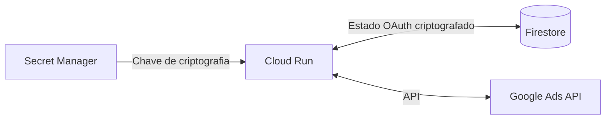

# 02 · Do código ao servidor: implantação no Cloud Run

[English](../en/getting-started/DEPLOY.md) · [Índice](../README.md)

Vamos montar uma pequena oficina: o Cloud Build monta a aplicação, o Artifact Registry guarda a imagem e o Cloud Run a executa. O Firestore preserva o estado de autorização quando o contêiner reinicia. Cada peça tem um motivo; confira o resultado antes de encaixar a próxima.

**Antes de começar:** conclua os [pré-requisitos](PREREQUISITES.md), inclusive faturamento, permissões e nível de acesso à Google Ads API. Use um projeto de laboratório dedicado e **o mesmo projeto para OAuth, API e execução** neste roteiro. Organizações podem exigir apoio de TI para IAM, OAuth e exposição HTTP.

Base técnica e escopo desta revisão

O guia parte do commit upstream `44ca7770519362c8f334875477e1ceb499f8d2dd`, conferido em 21/11/2026. O pacote declara 0.0.6, mas o commit não é apresentado como uma release estável marcada. A revisão documental não executou novo build nem deploy no Google Cloud. Dependências e imagens-base upstream usam intervalos ou tags móveis; registre o digest produzido.

Execute um comando por vez e confira sua saída. Se qualquer comando falhar, pare antes do próximo: o Bash interativo não interrompe automaticamente o restante de um bloco colado. Os checkpoints abaixo só valem quando todos os comandos anteriores terminaram com sucesso.

## 1. Abrir a bancada

No [Google Cloud Console](https://console.cloud.google.com/), abra **Cloud Shell** pelo ícone de terminal no alto da página. Autorize a sessão se o Console solicitar. Os comandos usam **Bash no Cloud Shell**; não os execute diretamente no PowerShell ou Prompt de Comando do Windows.

~~~bash
git clone https://github.com/alexandreninja/google-ads-mcp-cloud-run-guide.git
cd google-ads-mcp-cloud-run-guide
export GUIDE_DIR="$PWD"
~~~

Se a pasta já existir, entre no clone correto; não apague seu trabalho para repetir o exemplo. **Checkpoint:** a saída de pwd termina em google-ads-mcp-cloud-run-guide e a pasta config contém as configurações do guia.

## 2. Identificar o projeto antes de criar recursos

Substitua apenas SEU_PROJECT_ID. O ID não é o nome de exibição nem o número do projeto. A região é um exemplo; escolha localização e custos conforme sua necessidade e as regras da organização.

~~~bash
export PROJECT_ID="SEU_PROJECT_ID"
export REGION="us-central1"
export REPOSITORY="mcp-servers"
export SERVICE="google-ads-mcp"
export RUNTIME_SA_NAME="google-ads-mcp-runtime"
export BUILD_SA_NAME="google-ads-mcp-build"
export RUNTIME_SA_EMAIL="$RUNTIME_SA_NAME@$PROJECT_ID.iam.gserviceaccount.com"
export BUILD_SA_EMAIL="$BUILD_SA_NAME@$PROJECT_ID.iam.gserviceaccount.com"
export SOURCE_BUCKET="gs://$PROJECT_ID-mcp-source"
export FIRESTORE_DATABASE="(default)"
export UPSTREAM_COMMIT="44ca7770519362c8f334875477e1ceb499f8d2dd"
export UPSTREAM_DIR="$GUIDE_DIR/.work/google-ads-mcp"
export IMAGE="$REGION-docker.pkg.dev/$PROJECT_ID/$REPOSITORY/$SERVICE:44ca77705193"

gcloud config set project "$PROJECT_ID"
gcloud projects describe "$PROJECT_ID" --format='value(projectId,name)'
gcloud auth list --filter=status:ACTIVE --format='value(account)'
~~~

**Checkpoint:** projeto e identidade correspondem ao laboratório autorizado. Confira o faturamento no Console e defina [alertas de orçamento](../guides/COSTS.md). Os próximos passos criam recursos e podem gerar cobrança. Limitar instâncias não limita o valor da fatura. Se o Cloud Shell reiniciar, redefina as variáveis desta seção.

## 3. Habilitar as APIs

~~~bash
gcloud services enable \
  googleads.googleapis.com \
  run.googleapis.com \
  cloudbuild.googleapis.com \
  artifactregistry.googleapis.com \
  secretmanager.googleapis.com \
  firestore.googleapis.com \
  storage.googleapis.com \
  logging.googleapis.com \
  iam.googleapis.com \
  --project="$PROJECT_ID"
~~~

**Checkpoint:** o comando termina sem erro. Habilitar a Google Ads API concede acesso de teste; consultar contas de produção requer o nível adequado no projeto OAuth. Desde 09/09/2026, o onboarding usa o projeto Cloud; não solicite developer token seguindo vídeos antigos. Veja os [pré-requisitos](PREREQUISITES.md).

## 4. Separar identidades e criar os depósitos

A identidade que constrói a imagem não precisa ler segredos OAuth. A identidade que executa o servidor não precisa construir imagens. Essa separação reduz o alcance de cada conta de serviço.

~~~bash
gcloud iam service-accounts create "$BUILD_SA_NAME" \
  --display-name="Build do Google Ads MCP" --project="$PROJECT_ID"
gcloud iam service-accounts create "$RUNTIME_SA_NAME" \
  --display-name="Execucao do Google Ads MCP" --project="$PROJECT_ID"

gcloud artifacts repositories create "$REPOSITORY" \
  --repository-format=docker --location="$REGION" \
  --description="Imagens do laboratorio MCP" --project="$PROJECT_ID"

gcloud storage buckets create "$SOURCE_BUCKET" \
  --location="$REGION" --uniform-bucket-level-access --project="$PROJECT_ID"

gcloud artifacts repositories add-iam-policy-binding "$REPOSITORY" \
  --location="$REGION" --member="serviceAccount:$BUILD_SA_EMAIL" \
  --role=roles/artifactregistry.writer --project="$PROJECT_ID"
gcloud storage buckets add-iam-policy-binding "$SOURCE_BUCKET" \
  --member="serviceAccount:$BUILD_SA_EMAIL" --role=roles/storage.objectViewer
gcloud projects add-iam-policy-binding "$PROJECT_ID" \
  --member="serviceAccount:$BUILD_SA_EMAIL" --role=roles/logging.logWriter
~~~

O operador humano do Cloud Shell precisa enviar a origem, consultar o status do build, ler a imagem para implantá-la e atuar como as duas contas de serviço. Substitua `SEU_EMAIL_GOOGLE` pelo e-mail da identidade ativa conferida na etapa 2; este exemplo usa uma identidade de usuário, não uma conta de serviço ou um grupo. Os vínculos IAM abaixo devem ser aplicados por uma pessoa autorizada a alterar as políticas desses recursos. Se você não tiver essa permissão, peça à administração que execute os comandos de concessão com `OPERATOR_EMAIL` apontando para a identidade que fará o build e o deploy.

~~~bash
export OPERATOR_EMAIL="SEU_EMAIL_GOOGLE"
gcloud storage buckets add-iam-policy-binding "$SOURCE_BUCKET" \
  --member="user:$OPERATOR_EMAIL" --role=roles/storage.objectCreator
gcloud storage buckets add-iam-policy-binding "$SOURCE_BUCKET" \
  --member="user:$OPERATOR_EMAIL" --role=roles/storage.legacyBucketReader
gcloud artifacts repositories add-iam-policy-binding "$REPOSITORY" \
  --location="$REGION" --member="user:$OPERATOR_EMAIL" \
  --role=roles/artifactregistry.reader --project="$PROJECT_ID"
gcloud projects add-iam-policy-binding "$PROJECT_ID" \
  --member="user:$OPERATOR_EMAIL" --role=roles/cloudbuild.builds.editor
gcloud projects add-iam-policy-binding "$PROJECT_ID" \
  --member="user:$OPERATOR_EMAIL" --role=roles/serviceusage.serviceUsageConsumer
for ACT_AS_EMAIL in "$BUILD_SA_EMAIL" "$RUNTIME_SA_EMAIL"; do
  gcloud iam service-accounts add-iam-policy-binding "$ACT_AS_EMAIL" \
    --member="user:$OPERATOR_EMAIL" --role=roles/iam.serviceAccountUser \
    --project="$PROJECT_ID"
done
~~~

O papel `roles/storage.legacyBucketReader` inclui `storage.buckets.get`, necessário para consultar metadados do bucket, e também permite listar nomes e metadados de objetos; mantenha este bucket dedicado aos arquivos de origem do build. `roles/cloudbuild.builds.editor` permite criar e consultar builds; `roles/serviceusage.serviceUsageConsumer` inclui `serviceusage.services.use`, necessário para comandos `gcloud builds` com esse papel. A conta de build continua com acesso de leitura à origem, escrita no Artifact Registry e escrita de logs; o operador recebe leitura da imagem no repositório para o deploy. Consulte os papéis do [Cloud Build](https://docs.cloud.google.com/build/docs/iam-roles-permissions), as permissões para [executar comandos `gcloud builds`](https://docs.cloud.google.com/build/docs/securing-builds/configure-access-to-resources), do [Cloud Storage](https://docs.cloud.google.com/storage/docs/access-control/iam-roles) e do [Artifact Registry](https://cloud.google.com/artifact-registry/docs/access-control).

**Checkpoint:** confirme que `OPERATOR_EMAIL` é a identidade ativa da etapa 2 e que ela tem `roles/storage.objectCreator` e `roles/storage.legacyBucketReader` no bucket; `roles/artifactregistry.reader` no repositório; `roles/cloudbuild.builds.editor` e `roles/serviceusage.serviceUsageConsumer` no projeto; e `roles/iam.serviceAccountUser` nas contas de build e execução. A conta de build deve ter os três acessos destinados a ela no bloco anterior. Para publicar o serviço, o operador também precisa das permissões de Cloud Run listadas nos [pré-requisitos](PREREQUISITES.md). Se um recurso já existir, confira projeto e região antes de reaproveitá-lo. Não trate `Permission denied` como `Already exists` nem conceda `Owner` ou `Storage Admin` para contornar um acesso ausente.

## 5. Preservar a autorização fora do contêiner

O contêiner é uma bancada substituível: sua memória desaparece quando o processo termina. O Firestore guarda o estado OAuth fora do processo; o Secret Manager fornece a chave de criptografia. Nenhum deles mantém um stream HTTP aberto.

Em um **projeto dedicado sem banco anterior**, crie Firestore Standard em Native mode. Reveja a localização antes da criação. Se já existir um banco (default), confirme tipo e localização; não substitua nem altere um banco de produção para seguir o exemplo.

~~~bash
gcloud firestore databases create --database="$FIRESTORE_DATABASE" \
  --location="$REGION" --type=firestore-native --edition=standard \
  --project="$PROJECT_ID"
gcloud projects add-iam-policy-binding "$PROJECT_ID" \
  --member="serviceAccount:$RUNTIME_SA_EMAIL" --role=roles/datastore.user \
  --condition="expression=resource.name==\"projects/$PROJECT_ID/databases/$FIRESTORE_DATABASE\",title=McpFirestoreAccess,description=OAuth persistent storage"
gcloud firestore databases describe --database="$FIRESTORE_DATABASE" \
  --project="$PROJECT_ID"
~~~

**Checkpoint:** o banco está disponível em Native mode. A condição limita esta concessão ao banco indicado, não a coleções individuais. Mantenha o laboratório isolado e confira acesso efetivo durante OAuth. O Firestore guarda estado OAuth, não um banco de indicadores nem todas as sessões HTTP. O backend upstream filtra registros expirados na leitura, mas não os remove automaticamente; planeje [limpeza e retenção](../guides/OPERATIONS.md).

## 6. Preparar OAuth e três versões de segredos

Siga [03 · OAuth e Secret Manager, até o checkpoint anterior ao deploy](../guides/OAUTH-AND-SECRETS.md). Volte com OAUTH_CLIENT_ID definido e três segredos existentes, cada um com a versão **1** habilitada e acesso concedido à conta de execução. Não continue com recipientes vazios.

## 7. Preparar e construir o servidor oficial

~~~bash
mkdir -p "$GUIDE_DIR/.work"
git clone https://github.com/googleads/google-ads-mcp.git "$UPSTREAM_DIR"
git -C "$UPSTREAM_DIR" checkout --detach "$UPSTREAM_COMMIT"
python3 "$GUIDE_DIR/scripts/prepare_source.py" "$UPSTREAM_DIR"
git -C "$UPSTREAM_DIR" rev-parse HEAD
git -C "$UPSTREAM_DIR" diff -- Dockerfile
cat "$UPSTREAM_DIR/tools_config.yaml"
~~~

O helper aceita somente a origem oficial e o commit fixado em um checkout sem alterações, arquivos não rastreados ou itens ignorados. Ele prepara esse checkout localmente: habilita a dependência opcional Firestore no Dockerfile e grava a configuração que expõe apenas customers, search e metadata, com labels e assets desabilitadas. Preserva o restante do Dockerfile, incluindo os ajustes de compatibilidade FastMCP do upstream.

> [!IMPORTANT]
> Continue somente se o SHA for `44ca7770519362c8f334875477e1ceb499f8d2dd`, a instalação incluir o extra `.[firestore]` e `labels` e `assets` estiverem `false`. Isso limita as ferramentas disponíveis nesta imagem; não reduz o escopo OAuth `adwords`, as permissões da identidade Google nem outros acessos à API.

> [!NOTE]
> Uma execução bem-sucedida modifica o checkout preparado e não pode ser reaplicada nessa pasta. Para repetir a preparação, faça um novo clone do commit fixado em outra pasta, atualize `UPSTREAM_DIR` e recomece esta etapa. Não faça reset nem limpeza destrutiva no checkout existente.

~~~bash
gcloud builds submit "$UPSTREAM_DIR" \
  --config="$GUIDE_DIR/config/cloudbuild.yaml" \
  --substitutions="_IMAGE=$IMAGE" \
  --service-account="projects/$PROJECT_ID/serviceAccounts/$BUILD_SA_EMAIL" \
  --gcs-source-staging-dir="$SOURCE_BUCKET/source" \
  --project="$PROJECT_ID"
~~~

**Checkpoint:** o build informa SUCCESS e a imagem aparece no Artifact Registry. Registre seu digest exibido no build. O contexto enviado é o checkout oficial preparado; não coloque credenciais nessa pasta. Downloads, quotas ou dependências podem impedir o build mesmo com o commit fixado. Não remova verificações do Dockerfile para forçar um sucesso.

## 8. Implantar e descobrir a URL

Este é um piloto com uma instância no máximo e escala a zero. Mantém o HTTP stateful upstream e a concorrência padrão do Cloud Run. Não configure concorrência 1 com streams SSE longos: uma conexão pode ocupar a única vaga. Não é uma arquitetura de alta disponibilidade. O timeout de 300 segundos encerra solicitações HTTP longas após cinco minutos; clientes que mantêm streams precisam conseguir reconectar.

> [!WARNING]
> `--allow-unauthenticated` deixa a entrada do Cloud Run acessível pela internet para iniciar OAuth. O OAuth protege as ferramentas, mas não bloqueia tráfego anônimo no endpoint nem os custos que ele pode gerar. Se a política da organização impedir exposição pública, pare e peça à equipe de TI uma arquitetura compatível; não contorne a política.

~~~bash
gcloud run deploy "$SERVICE" \
  --image="$IMAGE" --region="$REGION" --platform=managed \
  --service-account="$RUNTIME_SA_EMAIL" \
  --allow-unauthenticated --min-instances=0 --max-instances=1 \
  --cpu=1 --memory=1Gi --timeout=300 \
  --set-env-vars="GOOGLE_CLOUD_PROJECT=$PROJECT_ID,GOOGLE_ADS_MCP_OAUTH_CLIENT_ID=$OAUTH_CLIENT_ID,GOOGLE_ADS_MCP_STORAGE_TYPE=firestore,GOOGLE_ADS_MCP_STORAGE_FIRESTORE_PROJECT=$PROJECT_ID,GOOGLE_ADS_MCP_STORAGE_FIRESTORE_DATABASE=$FIRESTORE_DATABASE,GOOGLE_ADS_MCP_TOOLS_CONFIG=/app/tools_config.yaml" \
  --set-secrets="GOOGLE_ADS_MCP_OAUTH_CLIENT_SECRET=google-ads-mcp-oauth-client-secret:1,GOOGLE_ADS_MCP_JWT_SIGNING_KEY=google-ads-mcp-jwt-signing-key:1,GOOGLE_ADS_MCP_STORAGE_ENCRYPTION_KEY=google-ads-mcp-storage-key:1" \
  --project="$PROJECT_ID"

export SERVICE_URL="$(gcloud run services describe "$SERVICE" \
  --region="$REGION" --project="$PROJECT_ID" --format='value(status.url)')"
printf '%s\n' "$SERVICE_URL"

gcloud run services update "$SERVICE" --region="$REGION" \
  --update-env-vars="GOOGLE_ADS_MCP_BASE_URL=$SERVICE_URL" \
  --project="$PROJECT_ID"
~~~

Na primeira revisão, a URL base ainda é a padrão local; não inicie login antes da atualização. **Checkpoint:** a última revisão está pronta e a URL base é a HTTPS gerada, sem /mcp. Termine agora o [cadastro do callback OAuth](../guides/OAUTH-AND-SECRETS.md#depois-do-deploy-cadastrar-o-callback).

## 9. Obter a primeira evidência

Siga [04 · Validação](../guides/VALIDATION.md). Serviço pronto, HTTP 401 anônimo e login concluído são evidências diferentes; acesso à Google Ads API só está validado depois de uma consulta autorizada.

Para manter ou encerrar o laboratório, consulte [operação](../guides/OPERATIONS.md), [custos](../guides/COSTS.md) e [segurança](../../SECURITY.md). Apagar o Cloud Run não apaga imagens, segredos, bucket ou Firestore.

[← Pré-requisitos](PREREQUISITES.md) · [OAuth e segredos →](../guides/OAUTH-AND-SECRETS.md)

Já possui uma implantação em memória? Utilize o [roteiro de migração](../guides/OAUTH-PERSISTENCE.md), em vez de recriar o serviço.
