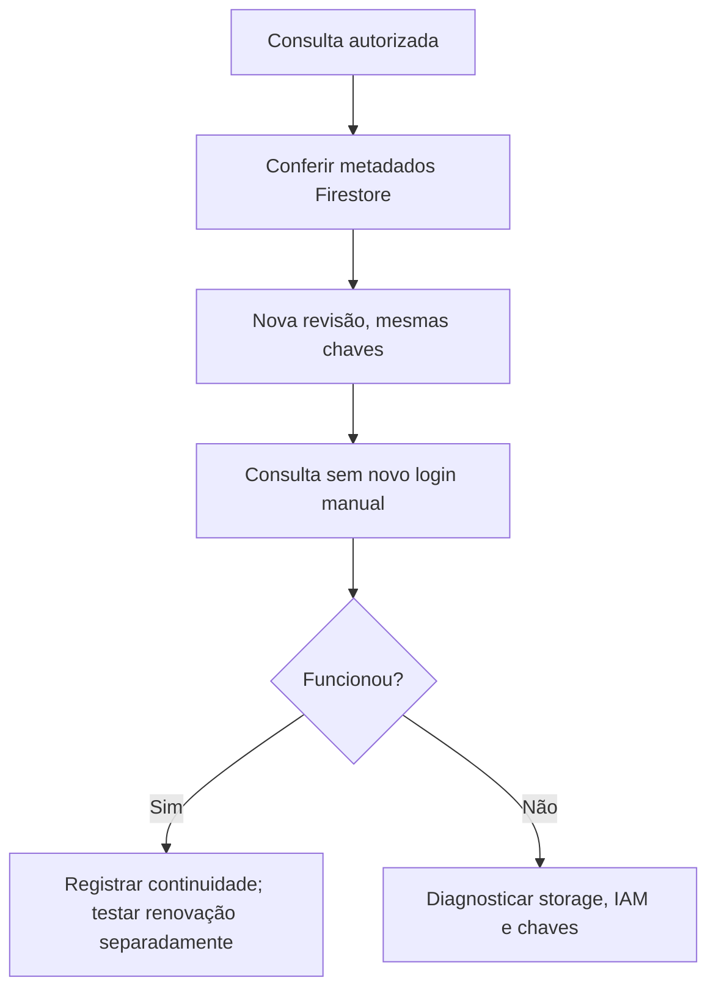

# 04 · Acendeu a luz? Validação do servidor e da consulta

[English](../en/guides/VALIDATION.md) · [Índice](../README.md)

Serviço pronto mostra que o contêiner iniciou. HTTP 401 mostra que uma requisição anônima foi recusada. Login mostra que a autorização avançou. **Só a consulta bem-sucedida comprova acesso à Google Ads API.** Vamos testar separadamente.

## 1. Conferir revisão e endpoint

No Cloud Shell, com as variáveis da [implantação](../getting-started/DEPLOY.md):

~~~bash
gcloud run services describe "$SERVICE" --region="$REGION" \
  --project="$PROJECT_ID" --format='yaml(status.conditions,status.url)'

curl --silent --show-error --output /dev/null --write-out '%{http_code}\n' \
  -X POST -H 'Content-Type: application/json' \
  --data '{"jsonrpc":"2.0","id":1,"method":"initialize","params":{"protocolVersion":"2025-03-26","capabilities":{},"clientInfo":{"name":"anonymous-check","version":"1.0"}}}' \
  "$SERVICE_URL/mcp"
~~~

**Esperado:** revisão pronta e autenticação exigida, normalmente com HTTP 401. Isso ainda não valida Client Secret, callback ou acesso Ads. O exemplo envia uma requisição anônima de um protocolo 2025 que o baseline mantém compatível; não é um cliente completo nem um teste universal para todo protocolo MCP. HTTP 404 pede conferir URL; 5xx pede logs de inicialização; 403 pode vir de IAM/rede antes do OAuth. Não remova autenticação para fazer o teste ficar verde.

## 2. Escolher um cliente

Use cliente instalado com MCP HTTP e OAuth. Acesso a modelos/assistentes pode depender de conta, plano e políticas corporativas. Consulte as [referências oficiais](../REFERENCES.md). Usar um assistente de IA como tutor para ler o guia é diferente de conectar um cliente MCP ao servidor.

### VS Code com agentes/Copilot habilitados

No seu computador, abra uma pasta no VS Code. Na paleta de comandos, procure **MCP: Add Server**, escolha HTTP, informe a URL com /mcp e dê um nome à conexão. Para configurar pela pasta, crie .vscode/mcp.json com o exemplo abaixo, substituindo apenas a URL. Não coloque segredos nem tokens nele. Este formato é **do VS Code**, não universal.

~~~json
{
  "servers": {
    "google-ads-mcp": {
      "type": "http",
      "url": "https://SEU-SERVICO.a.run.app/mcp"
    }
  }
}
~~~

Inicie a conexão pelo editor/comando MCP da sua versão. Revise a confiança no servidor e conclua o login Google com o usuário de teste autorizado. No chat de agentes, confira as ferramentas habilitadas e suas aprovações; não habilite execução irrestrita para pular um erro.

### Codex CLI já instalado e autenticado

Execute **no terminal do computador onde o Codex está instalado**, não no Cloud Shell por engano. As variáveis do Cloud Shell não são transferidas para ele.

~~~bash
export SERVICE_URL="https://SEU-SERVICO.a.run.app"
codex mcp add google-ads-mcp --url "$SERVICE_URL/mcp"
codex mcp login google-ads-mcp
codex mcp list
~~~

Se codex não for reconhecido, instale/configure-o pelo guia oficial antes de continuar. Esses comandos cadastram/autenticam a conexão; não consultam ferramentas. Abra uma sessão Codex na sua pasta para os próximos testes.

## 3. Conferir as ferramentas

Peça ao assistente:

> Liste as ferramentas deste servidor. Confirme customers_list_accessible_customers, metadata_get_resource_metadata e search_search. Não consulte dados ainda. Se encontrar ferramentas de criar ativos, enviar vídeos ou alterar rótulos, pare e informe: a configuração de leitura deste guia não está aplicada.

O baseline usa namespaces; versões antigas podem ter nomes diferentes. Ausência de ferramentas de mutação confirma a configuração deste servidor, não uma redução do escopo OAuth nem de todas as permissões da identidade Google.

## 4. Escolher uma conta autorizada

> Execute customers_list_accessible_customers. Mostre os IDs necessários para eu escolher uma conta autorizada. Não tente consultar contas que eu não indicar.

Selecione uma conta que você tenha autorização para consultar. `customer_id` identifica a conta-alvo; `login_customer_id` identifica a gerenciadora quando a chamada depende desse acesso.

> [!NOTE]
> A listagem não percorre a hierarquia da MCC: uma conta-filha acessível por meio da gerenciadora pode não aparecer nessa lista. Confirme o ID da filha com a equipe responsável e use `customer_id` da filha; informe `login_customer_id` da MCC na consulta quando o acesso depender dela.

## 5. Fazer uma consulta pequena

Primeiro consulte os metadados de `customer` para confirmar que os campos estão disponíveis. Metadados mostram o que pode ser consultado; use `search_search` para obter os valores da conta.

Escolha uma conta autorizada. Os itens abaixo são **argumentos para `search_search`**, não um comando Bash nem uma requisição HTTP completa. Substitua o ID e acrescente `login_customer_id` somente se seu acesso pela gerenciadora exigir.

~~~json
{
  "customer_id": "1234567890",
  "resource": "customer",
  "fields": [
    "customer.id",
    "customer.descriptive_name",
    "customer.currency_code",
    "customer.time_zone"
  ],
  "limit": 1
}
~~~

Use os valores retornados de `currency_code` e `time_zone` ao interpretar métricas e datas. Em seguida, escolha duas datas completas no fuso da conta e até dez linhas para a consulta de campanhas:

~~~json
{
  "customer_id": "1234567890",
  "resource": "campaign",
  "fields": [
    "campaign.id",
    "campaign.name",
    "metrics.impressions",
    "metrics.clicks",
    "metrics.cost_micros"
  ],
  "conditions": [
    "segments.date BETWEEN '2026-11-01' AND '2026-11-07'"
  ],
  "limit": 10
}
~~~

Prompt para acompanhar:

> Consulte metadados de campaign e confira a compatibilidade dos campos do exemplo. Use conta e datas que eu confirmar. Execute a consulta de leitura com dez linhas no máximo, sem filtro de status atual para este período histórico. Informe moeda e fuso da conta e mostre cost_micros original. Não invente números, não misture moedas e não trate dez linhas como o total da conta. Se não houver linhas, explique que resultado vazio pode ser válido e proponha como verificar conta, período e atividade.

Como `segments.date` está no filtro, mas não na lista de campos, cada linha agrega a campanha pelo intervalo inteiro. Se você incluir `segments.date` em `fields`, o resultado passa a ter uma linha por campanha e por dia. `limit: 10` limita as linhas retornadas; não representa o total do período. Se acrescentar `campaign.status`, interprete-o como o status atual da campanha, não como o status que ela tinha em cada data passada.

Faça a conversão de micros com aritmética decimal em código. Este exemplo é fictício; confirme o valor de `currency_code` em uma leitura de `customer` depois de verificar a disponibilidade do campo nos metadados. O valor abaixo não é uma resposta de conta real:

~~~python
from decimal import Decimal

currency_code = "BRL"  # exemplo fictício; substitua pelo valor lido da conta
cost_micros = 1_234_567  # exemplo fictício de metrics.cost_micros
cost = Decimal(cost_micros) / Decimal(1_000_000)

print(f"{currency_code} {cost}")  # BRL 1.234567
~~~

**Checkpoint:** confira uma campanha no Google Ads com a mesma conta, período e fuso. Métricas atribuídas pela plataforma não equivalem a cadastros validados em outro banco. Use SQL, Python e regras de negócio para cálculos e conciliação reproduzíveis; peça ao LLM para interpretar os resultados conferidos e propor hipóteses.

> [!IMPORTANT]
> O MCP faz esta consulta sob demanda. Este guia não configura extração recorrente, armazenamento analítico ou alimentação de dashboard.

## 6. Registrar o que realmente aconteceu

| Etapa | Evidência sem segredos |
| --- | --- |
| Build | Commit upstream, ID do build e digest da imagem |
| Serviço | Revisão pronta e URL base |
| Anônimo | Código HTTP e data; sem tokens/cabeçalhos de autorização |
| OAuth | Login concluído; sem copiar credenciais |
| Ferramentas | Três ferramentas de leitura presentes; mutações ausentes |
| Contas | Identidade/permissões conferidas; IDs ocultados ao compartilhar |
| Consulta | Campos, período, linhas, moeda e fuso conferidos |
| Resultado | Sucesso, vazio coerente ou erro diagnosticado; nunca “passou” sem executar |

Escala a zero, reinícios e novas revisões podem encerrar sessões MCP/streams HTTP mesmo com OAuth persistente no Firestore. Permita que o cliente restabeleça o transporte; não refaça a autorização manual durante o teste de persistência. não apague segredos ou banco para recuperar uma sessão. Se falhar, use [solução de problemas](TROUBLESHOOTING.md).

[← OAuth](OAUTH-AND-SECRETS.md) · [Erros e diagnóstico →](TROUBLESHOOTING.md)

## Continuidade OAuth entre revisões

Siga o [experimento de persistência](OAUTH-PERSISTENCE.md): compare consultas antes e depois da mudança de revisão sem reconexão OAuth manual. Teste renovação após expiração separadamente.

